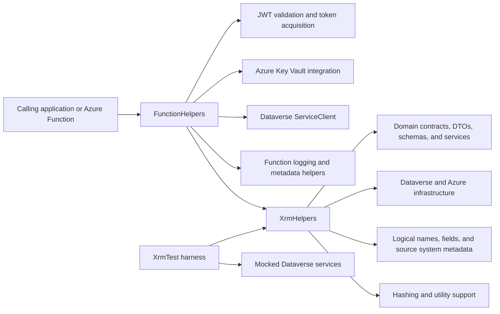
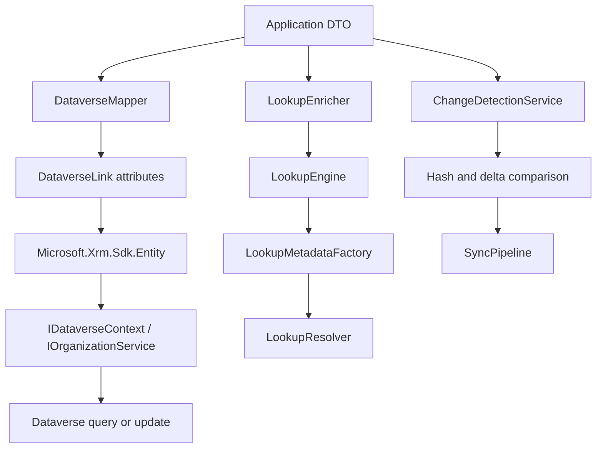
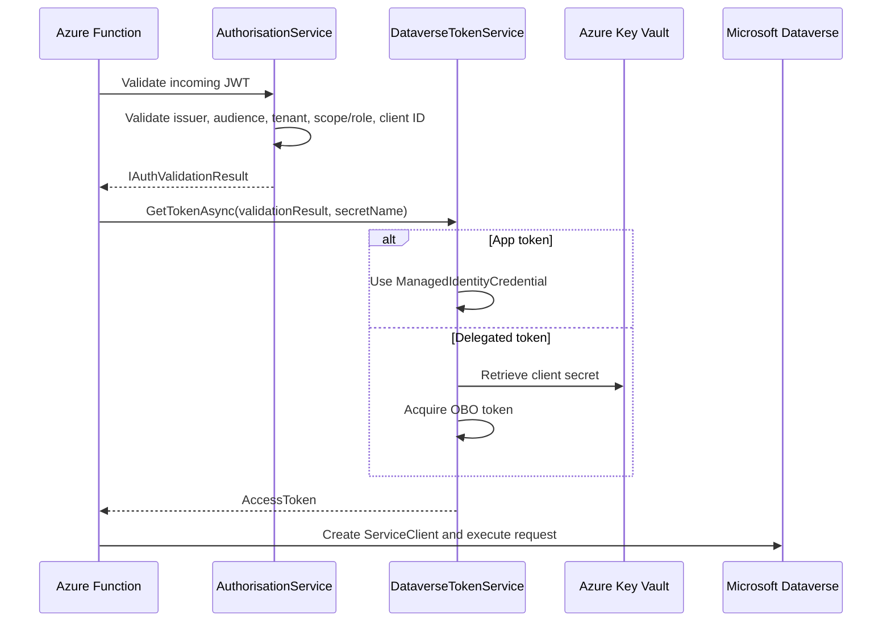
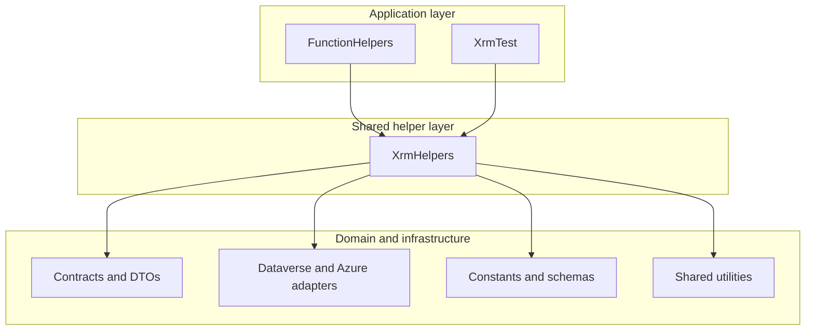

# SPGS Libraries

A collection of .NET libraries and supporting utilities for St. Paul's Grammar School's Microsoft Dataverse / Power Platform integrations. The repository is organized around reusable XRM domain helpers, Azure Functions integration services, and an executable test harness.

## Repository overview

The solution is composed of three projects:

- **XrmHelpers** — the main reusable helper library for Dataverse models, mappings, queries, validation, synchronization, and related infrastructure.
- **FunctionHelpers** — Azure Functions-oriented services for authentication, secrets, Dataverse clients, authorization, logging, and SharePoint metadata.
- **XrmTest** — an executable diagnostic/test harness that exercises XrmHelpers through mocked Dataverse services.

The solution file is [libraries.slnx](libraries.slnx). The projects target different frameworks:

- XrmHelpers: .NET Framework 4.6.2, .NET 8, and .NET 10.
- FunctionHelpers: .NET 8 and .NET 10.
- XrmTest: .NET 8 and .NET 10.

FunctionHelpers references XrmHelpers. XrmTest also references XrmHelpers. The XrmHelpers project includes a testing project under its Test directory, while the top-level XrmTest project is an executable smoke-test/demo harness.

## Architecture at a glance



## Module relationships

### 1. FunctionHelpers

FunctionHelpers is the Azure Functions-facing integration layer. It owns service abstractions and concrete implementations for the external boundaries used by functions:

- **Services/AuthorisationService** validates incoming JWTs, including issuer, audience, lifetime, tenant, delegated scope, application role, and allowed client identity checks.
- **Services/DataverseTokenService** selects the authentication flow. Delegated requests use an on-behalf-of token flow; application tokens use a managed identity credential. It caches a confidential client application and its client secret.
- **Services/DataverseService** creates a Microsoft Power Platform Dataverse ServiceClient using the token returned by DataverseTokenService and the configured environment URI.
- **Services/SecretService** retrieves secrets from Azure Key Vault through a TokenCredential-backed SecretClient.
- **Types** contains service contracts and shared configuration objects, including IDataverseService, IDataverseTokenService, IAuthorisationService, ISecretService, and ConfigOptions.
- **Helpers** contains request/query construction, entity mapping, MIME helpers, authorization headers, and generated-style template helper classes.
- **Implementations** supplies Azure Functions logging and SharePoint file metadata behavior.
- **Configuration** contains shared constants and the function logger adapter.
- **Enums/Identifiers** centralizes identifier values used by the helper layer.

FunctionHelpers depends on XrmHelpers for shared domain contracts such as IAuthValidationResult. Its project reference is the principal relationship from the Azure Functions layer to the broader XRM library.

### 2. XrmHelpers

XrmHelpers is the reusable business and integration library. It is designed around contracts and DTOs so callers can map application objects to Dataverse entities without coupling the rest of the library to a specific runtime or service implementation.

#### Domain

The Domain section describes the application model and its behavior:

- **Attributes** define metadata attached to DTO properties, including Dataverse links, lookup attributes, keys, hashes, touch timestamps, logical names, and notification metadata.
- **Contracts** define the interfaces and shared structures used by mappers, pipelines, lookup engines, validation, queries, and synchronization. This includes IDto, IDataverseMapper, ILookupEngine, IChangeDetectionService, ISyncPipeline, and validation contracts.
- **DTOs** represent business data such as students, staff members, job assignments, pay claims, safety incidents, notifications, themes, templates, and operational hierarchy maps.
- **Enums** represent business and Dataverse-backed states such as status, category, gender, campus, role, form type, and source system.
- **Models** contains shared model abstractions.
- **Resolvers** convert enum-like values and metadata into stable domain values.
- **Schemas** contain schema definitions for Dataverse entities.
- **Services** contains services for hashing, HTML enrichment, and related domain operations.

#### Constants

The Constants section provides stable metadata used by callers and infrastructure code:

- EntityLogicalNames identifies Dataverse entity logical names.
- SourceSystems identifies source-system values.
- Fields contains entity-specific field constants for HR, finance, configuration, compliance, and notification modules.
- BusinessUnitCodes contains business-unit identifiers.

These values are consumed by DTOs, mappers, queries, factories, and schema-related code, reducing string duplication and making Dataverse field names safer to evolve.

#### Infrastructure

The Infrastructure section contains concrete adapters around external systems:

- **Auth** handles access-token retrieval.
- **Azure/Vault** retrieves secrets from Azure Key Vault.
- **Dataverse/Context** wraps the XRM organization service, plugin execution context, and logger.
- **Dataverse/Queries** creates and executes typed QueryExpression objects for application entities.
- **Dataverse/Mappers** translate domain-specific records into and out of Dataverse entities.
- **Dataverse/Factories** construct application-specific Dataverse records and snapshots.
- **Dataverse/Resolvers** resolve lookup values and relationships.
- **Dataverse/Services** performs file upload/download operations and related Dataverse service calls.
- **Graph** contains Azure Graph-related helpers.
- **Http** contains HTTP request construction helpers.
- **Initialisers** creates organization services and service factories for plugin/runtime setup.

The Dataverse context is the central runtime boundary. Query and mapper components consume it through interfaces, allowing the surrounding code to work with an IOrganizationService-backed implementation without directly depending on the plugin runtime everywhere.

#### Serialization

The Serialisation section provides reflection- and attribute-driven conversion behavior. It supports mappings between DTO properties and Dataverse entity attributes, including nested links, option sets, GUIDs, aliases, and delta-based updates.

#### Shared

The Shared section contains reusable implementation utilities that are not specific to a single business domain:

- **Hashing** provides image, job snapshot, and BKDR hash helpers.
- **Utilities** provides safe string handling, Dataverse logging, and object-to-entity mapping support.

#### Archive

The Archive directory preserves older implementations, including prior student/staff-member mappings and snapshot factories. It is excluded from normal compilation in the XrmHelpers project and should be treated as historical reference material rather than the active design.

## Core data flow

A representative Dataverse mapping and synchronization flow is:



The key flow is:

1. A DTO carries business state and Dataverse metadata attributes.
2. DataverseMapper uses those attributes to map DTO values to or from a Microsoft.Xrm.Sdk.Entity.
3. Lookup enrichment uses metadata and resolver contracts to populate related values.
4. Change detection compares record state and hashes to identify what changed.
5. Sync pipelines consume the mapped values and the detected delta.
6. Infrastructure adapters execute the resulting Dataverse operations through IDataverseContext and IOrganizationService.

## Authentication and Dataverse access

The FunctionHelpers authentication flow is intentionally separated into validation and token acquisition:



The resulting service client uses the configured environment URI. The authentication layer therefore keeps request validation, application identity, secret retrieval, and Dataverse client construction as separate responsibilities.

## Dependency direction



The dependency direction is intentionally one-way: FunctionHelpers and XrmTest consume XrmHelpers, while XrmHelpers owns the domain and infrastructure abstractions used by both.

## Readability and extension points

When adding a new Dataverse-backed capability:

1. Add the domain contract or DTO where the public behavior is defined.
2. Add schema, field, enum, or resolver metadata when the underlying Dataverse model requires it.
3. Implement the behavior in the appropriate Infrastructure adapter.
4. Wire the implementation through the existing IServiceCollection registration extension or a dedicated dependency-injection registration.
5. Add or update the executable test harness using mocked Dataverse services to establish the expected behavior.

Keep the same layering for new functionality: avoid placing Azure Functions-specific authentication or logging in XrmHelpers, and avoid putting Dataverse operation details directly into DTOs or application-facing services.

## Building and testing

Restore and build the solution with:

```bash
dotnet restore libraries.slnx
dotnet build libraries.slnx
```

Run the executable harness with:

```bash
dotnet run --project XrmTest/XrmTest.csproj
```

The XrmHelpers test project can be run separately from its own directory:

```bash
dotnet test XrmHelpers/Test/custos.XrmHelpers.Test.csproj
```

The XrmTest project currently contains a console application rather than a conventional test suite. Its Program entry point sets up mocked IOrganizationService, IExecutionContext, and ITracingService instances, then exercises mapping, lookup enrichment, change detection, validation, and serialization components.

## Project notes

- Package versions are currently managed through the project files and the repository's NuGet configuration; no Directory.Packages.props file is present in this repository.
- XrmHelpers is signed and packages as custos.XrmHelpers.
- FunctionHelpers targets Azure Functions-compatible .NET frameworks and uses Azure Identity, Azure Key Vault Secrets, Microsoft.Identity.Client, and the Microsoft Dataverse client.
- Archive and legacy test code are retained for reference and are not the preferred path for new implementations.
- The codebase is actively evolving; use the current interfaces and service registrations as the source of truth rather than copied legacy implementations.
